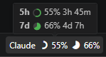

*다른 언어로 읽기: [English](README.md) | [中文](README-zh.md)*

# My Claude Usage

Claude Code 사용량(5시간 세션 · 주간)을 VS Code **상태 표시줄에 바로** 띄워주는 초경량 확장입니다. 클릭 한 번 없이 남은 한도를 한눈에 확인하세요. 별도 로그인 없이, 이미 설치된 **Claude Code의 인증을 그대로** 사용합니다.

  

## 📸 미리보기

  

## ✨ 왜 My Claude Usage 인가요?

Claude Code의 사용 한도는 별도로 확인하기 번거롭습니다. 이 확장은 사용량을 **상태 표시줄에 직접** 표시해, 작업 중 시선을 옮기지 않고도 항상 보이게 합니다.

- **미니멀**: `Claude ◔ 20% ◑ 45%` 처럼 5시간 세션(링)과 주간(파이) 사용률을 아이콘과 함께 표시합니다.
- **색상 경고**: 5h/7d 중 높은 사용량 기준으로 색으로 알려줍니다 — 70% 이상 노랑, 90% 이상 빨강.
- **깔끔한 툴팁**: 마우스를 올리면 `5h ◔ 20% 2h 15m`, `7d ◑ 45% 4d 3h` 두 줄로 사용률과 리셋까지 남은 시간을 보여줍니다.
- 무거운 웹뷰·대시보드 없음, 백그라운드 부담 없음.

## 🔐 인증 & 프라이버시

이미 로그인된 **Claude Code 자격증명을 자동으로** 읽습니다 (OS별로 위치가 다릅니다):

- **macOS**: 키체인 (`Claude Code-credentials`)
- **Windows / Linux**: `~/.claude/.credentials.json`
- 또는 `ANTHROPIC_API_KEY` 환경변수 (CI·컨테이너용 폴백)

네트워크 통신은 **공식 Anthropic 사용량 엔드포인트(`api.anthropic.com`) 한 곳뿐**이며, 본인의 토큰으로만 호출합니다.

- 제3자 서버로 데이터 전송 없음
- 텔레메트리·추적 없음
- 새 토큰을 만들거나 저장하지 않음 (Claude Code의 기존 인증을 읽기만 함)
- **macOS 주의**: 최초 실행 시 키체인 접근 허용 팝업이 뜰 수 있습니다 → **"항상 허용"** 을 눌러주세요.

## 🪶 초경량 (~14 KB)

`esbuild` 단일 번들로, 전체 확장이 약 14 KB(코드 약 11 KB + 아이콘 폰트 약 3 KB)에 불과합니다.

- VS Code API 외 런타임 의존성 0
- `onStartupFinished` 시점에만 활성화되는 초고속 로드

## ✅ 요구사항

- **Claude Code** 가 설치되어 있고 로그인되어 있어야 합니다 (자격증명이 있어야 사용량을 읽습니다).

## ⚙️ 설정 (Configuration)

| 설정 항목 | 기본값 | 설명 |
|---|---|---|
| `myClaudeUsage.refreshInterval` | `120` | 사용량 갱신 주기 (초 단위, 30~3600) |

## ⌨️ 명령어 (Commands)

| 명령어 | 단축키 | 설명 |
|---|---|---|
| `Claude Usage: Refresh Claude Usage` | `Ctrl/Cmd+Shift+R` | 사용량을 즉시 새로고침 |

상태 표시줄 항목을 클릭해도 즉시 새로고침됩니다.

## 🚀 설치 방법

1. VS Code 확장(Extensions) 탭(`Ctrl+Shift+X`)을 엽니다.
2. **My Claude Usage** 를 검색합니다.
3. **설치(Install)** 를 클릭하면 끝입니다.

## 📄 라이선스 (License)

[MIT License](LICENSE)
